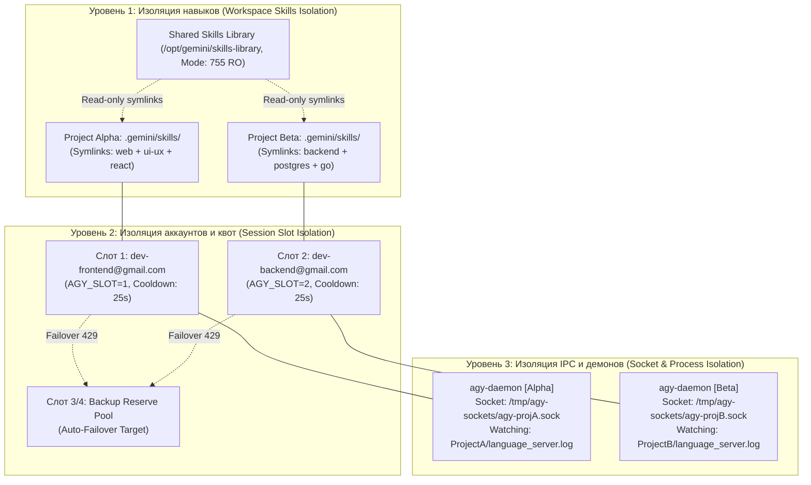

# 🚀 Multi-User Server Architecture & Deployment Guide: Absolute Antigravity & `agy` CLI (v3.0)

> **Production-Grade руководство системного инженера:** развертывание, администрирование и изоляция клиентов Google Antigravity и автономного ядра `agy` на многопользовательских серверах (Linux, WSL2, Ubuntu, Debian, Alpine, Fedora, Arch, Windows Server).


---

## 📑 Содержание
1. [Введение и архитектурные вызовы](#1-введение-и-архитектурные-вызовы)
2. [Трехуровневая модель изоляции](#2-трехуровневая-модель-изоляции)
3. [Сравнение сценариев: Сценарий 1 vs Сценарий 2](#3-сравнение-сценариев-сценарий-1-vs-сценарий-2)
4. [Сценарий 1: Раздельные пользователи ОС (User A & User B)](#4-сценарий-1-раздельные-пользователи-ос-user-a--user-b)
5. [Сценарий 2: Общий технический пользователь (Dev-Box / Remote Runner)](#5-сценарий-2-общий-технический-пользователь-dev-box--remote-runner)
6. [Скрипт-активатор `agy_project_env.sh` и терминальный воркфлоу](#6-скрипт-активатор-agy_project_envsh-и-терминальный-воркфлоу)
7. [Сквозной сценарий одновременной работы двух разработчиков](#7-сквозной-сценарий-одновременной-работы-двух-разработчиков)
8. [Управление демонами и IPC: Systemd интеграция](#8-управление-демонами-и-ipc-systemd-интеграция)
9. [Безопасность, права доступа и защита креденшелов](#9-безопасность-права-доступа-и-защита-креденшелов)
10. [Диагностика, аудит и устранение неполадок (Runbook)](#10-диагностика-аудит-и-устранение-неполадок-runbook)

---

## 1. Введение и архитектурные вызовы

При развертывании среды Antigravity на общем сервере разработки (remote server, dev-box, jump host, CI/CD runner или мощный сервер с GPU/CPU), за которым параллельно работают двое и более инженеров, возникают 4 критических конфликта:

```
┌────────────────────────────────────────────────────────────────────────┐
│                   ТИПИЧНЫЕ КОНФЛИКТЫ БЕЗ ИЗОЛЯЦИИ:                     │
├────────────────────────────────────────────────────────────────────────┤
│ 1. Конфликт квот Google AI (TPM/RPM 429 ResourceExhausted):           │
│    Один разработчик запустил тяжелый рефакторинг -> исчерпал лимиты    │
│    аккаунта -> второй разработчик получает блокировку и отказ LLM.     │
├────────────────────────────────────────────────────────────────────────┤
│ 2. Конфликт контекста и пресетов (Context Pollution):                  │
│    Dev A переключает глобальный пресет на 'web' -> у Dev B в Backend-  │
│    проекте активируются React/Tailwind и отключаются SQL/Postgres DBA.  │
├────────────────────────────────────────────────────────────────────────┤
│ 3. Конфликт сокетов и демонов (IPC Named Pipe / Socket Collision):     │
│    Один процесс agy-daemon занимает сокет /tmp/antigravity-ipc.sock,   │
│    перехватывая запросы и путая лог-файлы разных проектов.             │
├────────────────────────────────────────────────────────────────────────┤
│ 4. Утечка учетных записей (Credential Leakage):                       │
│    Разработчики не должны иметь доступ к OAuth-токенам друг друга.     │
└────────────────────────────────────────────────────────────────────────┘
```

Архитектура **Absolute Antigravity v3.0** решает эти проблемы через разделение ресурсов на системные (Shared Read-Only) и проектно-сессионные (Isolated Mutable).

---

## 2. Трехуровневая модель изоляции

Архитектура построена на 3 независимых слоях изоляции:



### 1. Изоляция пресетов на уровне проекта (Workspace Preset Isolation)
- Каталог навыков `skills-library` (101 навык) и манифест `presets.yaml` хранятся централизованно в `/opt/gemini/` в режиме **Read-Only** для всех пользователей (права `755`).
- Вместо записи в глобальный каталог `~/.gemini/config/skills/`, каждый проект монтирует активные навыки в собственный каталог `<workspace>/.gemini/skills/`.
- Переключение пресета в Проекте А (`agy-switch web`) создает локальные симлинки внутри Проекта А, **абсолютно не затрагивая** Проект Б.

### 2. Изоляция аккаунтов на уровне сессии (Session Slot Isolation)
- В системе настроен $N$-слотовый пул аккаунтов (хранилище WinCred / Linux Secret Service / `credentials_vault.json`).
- Сессия Разработчика 1 привязывается к переменной `AGY_SLOT=1`.
- Сессия Разработчика 2 привязывается к переменной `AGY_SLOT=2`.
- При исчерпании квоты (429 ResourceExhausted) Auto-Failover переключает только пострадавшую сессию на свободный резервный слот, не прерывая работу соседа.

### 3. Изоляция демонов и IPC сокетов (Socket & Process Isolation)
- Каждый проект получает уникальный хэш `PROJECT_HASH` (SHA-256 от абсолютного пути проекта).
- Сокет IPC демона создается по изолированному адресу:
  - Сценарий 1 (Разные пользователи): `/run/user/<UID>/agy.sock` (права `0700`, доступен только владельцу).
  - Сценарий 2 (Общий пользователь): `/tmp/agy-sockets/agy-$USER-${PROJECT_HASH}.sock`.
- Каждый экземпляр `agy-daemon` отслеживает **только лог-файл своего проекта** (`<workspace>/.gemini/language_server.log`).

---

## 3. Сравнение сценариев: Сценарий 1 vs Сценарий 2

| Критерий | Сценарий 1: Раздельные пользователи ОС | Сценарий 2: Общий пользователь (Dev-Box) |
|---|---|---|
| **Идентификация** | Разные системные логины (`alice`, `bob`) | Один логин (`dev` / `ubuntu` / `runner`) |
| **Граница изоляции** | Ядро Linux: UID, GID, POSIX `$HOME`, cgroups | Переменные окружения, пути рабочих каталогов |
| **Креденшелы** | Полная приватность (`~/.gemini/` права `0700`) | Разделение по слотам (`AGY_SLOT=1`, `AGY_SLOT=2`) |
| **IPC Сокеты** | `/run/user/<UID>/agy.sock` | `/tmp/agy-sockets/agy-${PROJECT_HASH}.sock` |
| **Запуск демона** | `systemctl --user start agy-daemon` | `agy-daemon-start` или `systemctl start agy-project@<hash>` |
| **Рекомендуется для** | Корпоративных серверов, постоянных рабочих станций | Удаленных серверов разработки, Docker, CI/CD раннеров |

---

## 4. Сценарий 1: Раздельные пользователи ОС (User A & User B)

В этом сценарии разработчики подключаются к серверу под собственными учетными записями Linux по SSH или через VS Code Remote / Antigravity Remote.

### Шаг 1. Глобальная установка бинарников и библиотек
Выполните установку от имени `root`:

```bash
# Клонирование репозитория (если еще не склонирован)
git clone https://github.com/google/antigravity /opt/antigravity-source
cd /opt/antigravity-source

# Установка ядра agy в /usr/local/bin и развертывание /opt/gemini
sudo ./scripts/install_linux.sh --system
```

### Шаг 2. Запуск скрипта подготовки окружения
Инициализируйте пользователей `alice` и `bob`:

```bash
sudo ./scripts/server_setup.sh --scenario 1 --users "alice bob"
```

Скрипт автоматически:
1. Создаст группу `agy-users` и включит в нее пользователей.
2. Скопирует 101 навык в `/opt/gemini/skills-library` с правами `0755 root:agy-users`.
3. Создаст структуру в домашних директориях пользователей (`~alice/.gemini/`, `~bob/.gemini/`) с правами `0700`.
4. Создаст симлинк `~/.gemini/skills-library -> /opt/gemini/skills-library`.
5. Установит systemd user-unit `/etc/systemd/user/agy-daemon.service`.
6. Активирует linger для пользователей (`loginctl enable-linger alice bob`), чтобы сервисы работали без активной графической сессии.

### Шаг 3. Авторизация аккаунтов разработчиков

Каждый разработчик авторизует свой Google-аккаунт в изолированном хранилище:

```bash
# Под пользователем Alice
su - alice
agy account add
# Выполните авторизацию в браузере -> токен сохранится в ~alice/.gemini/credentials_vault.json (0600)

# Под пользователем Bob
su - bob
agy account add
# Токен сохранится в ~bob/.gemini/credentials_vault.json (0600)
```

### Шаг 4. Активация демонов пользователей
Каждый пользователь запускает свой персональный watchdog-сервис:

```bash
systemctl --user enable --now agy-daemon
systemctl --user status agy-daemon
```

---

## 5. Сценарий 2: Общий технический пользователь (Dev-Box / Remote Runner)

Когда на сервере существует только один технический пользователь (например, `ubuntu`, `developer` или `runner`), а разработчики подключаются к разным каталогам проектов.

### Шаг 1. Разметка слотов проектов через `server_setup.sh`

Предположим, на сервере ведется работа над двумя проектами:
- `/var/www/frontend-app` (Разработчик 1, фронтенд)
- `/var/www/backend-api` (Разработчик 2, бэкенд)

Запустите настройку слотов:

```bash
./scripts/server_setup.sh --scenario 2 --projects "/var/www/frontend-app /var/www/backend-api"
```

Скрипт создаст:
1. Каталог сокетов `/tmp/agy-sockets` с правами `1777`.
2. Конфигурацию `<project>/.agy/config.json` с привязкой слота и уникального хэша:
   - `frontend-app` -> Слот 1, сокет `/tmp/agy-sockets/agy-a1b2c3d4.sock`
   - `backend-api`  -> Слот 2, сокет `/tmp/agy-sockets/agy-e5f6g7h8.sock`
3. Локальные песочницы навыков: `<project>/.gemini/skills/`.
4. Скрипт активации `<project>/.env.agy`.

### Шаг 2. Наполнение пула аккаунтов в общем хранилище
Один раз наполните пул слотов Google-аккаунтами:

```bash
# Добавление аккаунта для Слота 1 (Фронтенд разработчик)
agy account add
# Добавление аккаунта для Слота 2 (Бэкенд разработчик)
agy account add
# Добавление резервного аккаунта (Слот 3) на случай исчерпания квот
agy account add

# Проверка пула:
agy account status
```
*Вывод команды:*
```text
👤 Учетные записи Google Antigravity:
------------------------------------------------------------
Активный слот: [1/3] dev-frontend@gmail.com
Автопереход при 429 (Auto-Failover): Включен
------------------------------------------------------------
  ▶ [Слот 1] dev-frontend@gmail.com (ACTIVE)
    [Слот 2] dev-backend@gmail.com
    [Слот 3] reserve-pool@gmail.com
------------------------------------------------------------
```

---

## 6. Скрипт-активатор `agy_project_env.sh` и терминальный воркфлоу

Для моментальной изоляции сессии терминала используется скрипт-хелпер `scripts/agy_project_env.sh`.

> [!IMPORTANT]
> Скрипт необходимо вызывать через команду `source` (или `.`), чтобы экспортированные переменные и функции применились к вашей текущей оболочке shell.

### Синтаксис вызова:
```bash
source scripts/agy_project_env.sh [номер_слота] [пресет] [путь_к_проекту]
```

### Что происходит при выполнении:
1. Вычисляется `AGY_PROJECT_HASH` от рабочего каталога.
2. Экспортируются изолированные переменные окружения:
   - `AGY_WORKSPACE` — корень проекта.
   - `AGY_SLOT` — выделенный слот аккаунта (1, 2 и т.д.).
   - `AGY_PRESET` — целевой пресет (например, `web`, `backend`, `devops`).
   - `AGY_SOCKET` — выделенный путь Unix Domain Socket для IPC.
   - `AGY_CONFIG_DIR` — локальный путь `<workspace>/.gemini/config`.
3. В `<workspace>/.gemini/skills/` монтируются симлинки только тех навыков, которые входят в выбранный пресет + 5 фундаментальных мета-скиллов (`ALWAYS_ACTIVE`).
4. В оболочку внедряются удобные функции-хелперы:
   - `agy-status` — полный статус проекта, слота, квоты и демона.
   - `agy-switch <preset>` — изолированная смена пресета только для текущего проекта.
   - `agy-daemon-start` — фоновый запуск сторожевого демона для текущего проекта.
   - `agy-daemon-stop` — корректная остановка демона.

---

## 7. Сквозной сценарий одновременной работы двух разработчиков

Рассмотрим реальный пример: два инженера работают параллельно на одном сервере.

### 💻 Терминал 1: Разработчик 1 (Alice — Web Frontend)
```bash
# Переход в проект Фронтенда
cd /var/www/frontend-app

# Активация Слота 1 и пресета "web"
source /usr/local/bin/agy_project_env.sh 1 web

# Запуск демона проекта
agy-daemon-start
```

*Баннер в Терминале 1:*
```text
  🚀 Absolute Antigravity Project Environment Activated!
  📂 Workspace: /var/www/frontend-app
  👤 Slot:      [Slot 1]
  🎛️ Preset:    web
  🔌 Socket:    /tmp/agy-sockets/agy-dev-a1b2c3d4.sock

  Available project commands:
    agy-status        - Inspect current slot, quota & preset status
    agy-switch <name> - Switch preset for this project
    agy-daemon-start  - Start isolated project IPC watchdog
    agy-daemon-stop   - Stop project watchdog
```

Alice работает над интерфейсом на React/Next.js. В ее окружении активно 17 скиллов (`react-best-practices`, `tailwind-v4-master`, `ui-ux-pro-max`, `figcraft-design` и др.). Токены оптимизированы до ~2,400.

Теперь Alice нужно написать E2E-тесты. Она выполняет:
```bash
agy-switch qa
```
Симлинки в `/var/www/frontend-app/.gemini/skills/` мгновенно переключаются на Playwright и TDD.

---

### 💻 Терминал 2: Разработчик 2 (Bob — Go Backend & PostgreSQL)
В это же самое время в соседней SSH-сессии или tmux-окне:

```bash
# Переход в проект Бэкенда
cd /var/www/backend-api

# Активация Слота 2 и пресета "backend"
source /usr/local/bin/agy_project_env.sh 2 backend

# Запуск демона проекта
agy-daemon-start
```

*Баннер в Терминале 2:*
```text
  🚀 Absolute Antigravity Project Environment Activated!
  📂 Workspace: /var/www/backend-api
  👤 Slot:      [Slot 2]
  🎛️ Preset:    backend
  🔌 Socket:    /tmp/agy-sockets/agy-dev-e5f6g7h8.sock
```

Bob работает над базой данных. В его окружении активны `postgres-dba-optimizer`, `go-concurrency-patterns`, `fastapi-async-architect`, `redis-distributed-caching`.

#### 🛡️ Что происходит при возникновении ошибки 429 у Bob:
1. Bob генерирует сложную миграцию БД, отправляя большой контекст -> Google API возвращает `ResourceExhausted (429)`.
2. Сторожевой процесс `agy-daemon` Bob'а (слушающий сокет `agy-dev-e5f6g7h8.sock` и лог `/var/www/backend-api/.gemini/language_server.log`) фиксирует событие 429.
3. Демон выполняет ротацию слота для Bob'а: со **Слота 2** на резервный **Слот 3** (`reserve-pool@gmail.com`).
4. **У Alice в Терминале 1 ничего не меняется:** ее Слот 1 продолжает работать штатно, ее сокет изолирован, сессия не прерывается.

---

## 8. Управление демонами и IPC: Systemd интеграция

Для обеспечения автозапуска и надежности (Watchdog 24/7) предусмотрены два варианта systemd-юнитов:

### Вариант А: Пользовательский сервис (Сценарий 1)
Управляется самим разработчиком без прав суперпользователя:

```bash
# Запуск и добавление в автозагрузку при старте системы
systemctl --user enable --now agy-daemon

# Просмотр логов в реальном времени
journalctl --user -u agy-daemon -f

# Перезапуск
systemctl --user restart agy-daemon
```

### Вариант Б: Шаблонный системный сервис для проектов (Сценарий 2)
Сервис `/etc/systemd/system/agy-project@.service` позволяет запускать демоны под конкретный проект через имя проекта:

```bash
# Запуск демона для проекта frontend-app
sudo systemctl enable --now agy-project@frontend-app

# Запуск демона для проекта backend-api
sudo systemctl enable --now agy-project@backend-api

# Статус всех сервисов Antigravity
systemctl list-units "agy-project@*"
```

---

## 9. Безопасность, права доступа и защита креденшелов

### 1. Защита хранилища учетных записей (POSIX Hardening)
Файл `~/.gemini/credentials_vault.json` содержит приватные OAuth refresh/access токены Google.
- Доступ строго ограничен: `chmod 0600` (только чтение/запись владельцем).
- Каталог `~/.gemini/`: `chmod 0700` (запрещен вход другим пользователям).
- Общий каталог сокетов `/tmp/agy-sockets`: `chmod 1777` (включен Sticky Bit, аналогично `/tmp` — ни один пользователь не может удалить или подменить чужой сокет).

### 2. Защита от подмены симлинков (Symlink Traversal Prevention)
Движок `agy` при монтировании навыков выполняет каноникализацию путей (`canonicalize()`), проверяя, что целевой каталог находится строго внутри авторизованной библиотеки `/opt/gemini/skills-library` или `~/.gemini/skills-library`. Попытки создать ссылки на системные каталоги (`/etc`, `/root`) пресекаются.

### 3. Защита Local HTTP IPC Bridge (порт 51122)
- Строгая фильтрация заголовка `Host`: разрешены только `127.0.0.1` и `localhost`.
- Строгая проверка заголовка `Origin`: блокировка внешних веб-страниц (защита от Drive-By атак и CORS-эксплуатации).

---

## 10. Диагностика, аудит и устранение неполадок (Runbook)

### Автоматический аудит окружения (`--doctor`)
Запустите диагностический скрипт для комплексной проверки прав, бинарников и изоляции:

```bash
./scripts/server_setup.sh --doctor
```

*Пример успешного вывода:*
```text
==================================================================
  🩺 ANTIGRAVITY SERVER MULTI-USER ISOLATION AUDIT               
==================================================================
Checking CLI binary (agy)... PASS (/usr/local/bin/agy)
Checking Daemon binary (agy-daemon)... PASS (/usr/local/bin/agy-daemon)
Checking shared skills library (/opt/gemini/skills-library)... PASS (101 skills present)
Checking socket directory permissions... PASS (/tmp/agy-sockets, mode: 1777)
Checking credentials vault security (~/.gemini/credentials_vault.json)... SECURE (mode 0600 - Owner Only)

✔ All system isolation checks passed cleanly!
```

---

### Типовые ситуации и их решение:

#### Проблема 1: Ошибка «Permission denied» при попытке подключиться к сокету
- **Причина:** Разработчик пытается подключиться к сокету чужого пользователя.
- **Решение:** Проверьте вывод `agy-status` и убедитесь, что переменная `AGY_SOCKET` указывает на сокет текущего пользователя (`/run/user/$UID/agy.sock` или `/tmp/agy-sockets/agy-$USER-*.sock`).

#### Проблема 2: «429 ResourceExhausted» на всех аккаунтах
- **Причина:** Все доступные слоты исчерпали квоту запросов.
- **Решение:**
  1. Проверьте статус слотов: `agy account status`.
  2. Добавьте дополнительный резервный аккаунт: `agy account add`.
  3. Увеличьте пул резервных аккаунтов. Cooldown автоматического сброса составляет 25 секунд.

#### Проблема 3: Старый зависший сокет после аварийного завершения сервера
- **Причина:** Предыдущий процесс демона был завершен сигналом `SIGKILL`, оставив файл сокета на диске.
- **Решение:**
  ```bash
  agy-daemon-stop
  # Или вручную удалить файл сокета своего проекта:
  rm -f "$AGY_SOCKET"
  agy-daemon-start
  ```

---

## 🏁 Сводка ключевых команд

| Команда | Описание |
|---|---|
| `sudo ./scripts/install_linux.sh --system` | Установка CLI и демона в `/usr/local/bin`, раскладка 101 навыка |
| `sudo ./scripts/server_setup.sh --scenario 1 --users "u1 u2"` | Развертывание среды для разных пользователей ОС |
| `./scripts/server_setup.sh --scenario 2 --projects "/p1 /p2"` | Развертывание слотов для проектов на одном dev-box |
| `source scripts/agy_project_env.sh 1 web` | Активация проекта: привязка Слота 1 и пресета `web` |
| `agy-status` | Просмотр текущего слота, квоты, сокета и пресета проекта |
| `agy-switch backend` | Мгновенная локальная смена пресета для текущего проекта |
| `agy account status` | Инспекция карусели Google-аккаунтов и состояния Auto-Failover |
| `agy account rotate [slot]` | Ручная ротация активного слота учетной записи |
| `agy-daemon-start` / `agy-daemon-stop` | Управление изолированным сторожевым демоном проекта |
| `./scripts/server_setup.sh --doctor` | Проверка целостности и безопасности многопользовательской среды |
