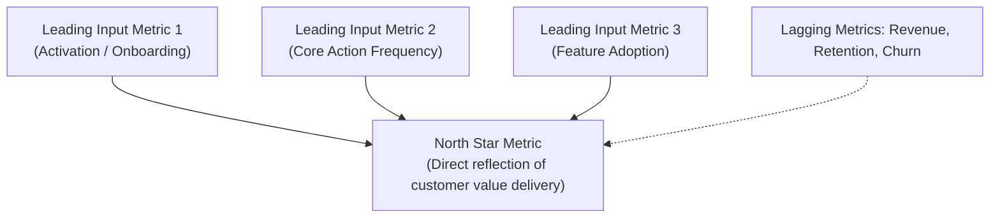

# Telemetry & Product Metrics Specification

If you cannot measure it, you cannot know if your product solved the user's problem. Telemetry must be designed *before* shipping, not patched in as an afterthought.

---

## 1. Metric Hierarchy

### The North Star Metric (NSM):
- **Definition**: The single metric that best captures the core value your product delivers to customers.
- **Example for Note-taking App**: *Weekly Active Users creating/editing >= 3 notes* (NOT just logins).
- **Example for Developer Tool**: *Weekly Active Repos running successful CLI builds* (NOT total downloads).

### Leading Indicators vs Lagging Metrics:
- **Lagging Metrics (Outcomes)**: Revenue, Churn, NPS. By the time they change, it is too late to react.
- **Leading Indicators (Inputs)**: Activation rate in the first 24 hours, time to complete first task, daily repetition of core action. These predict future success and can be influenced directly.

---

## 2. Event Naming Taxonomy: Object-Action Standard

To prevent chaotic telemetry logs, enforce the **Object-Action** standard:

$$\text{event\_name} = \text{object} + \text{"\_"} + \text{action}$$

### Examples:
| Category | Event Name | Trigger Condition |
| :--- | :--- | :--- |
| **Authentication** | `user_signed_up`, `user_logged_in` | Completed registration / auth callback |
| **Onboarding** | `workspace_created`, `sample_project_loaded` | First-mile completion steps |
| **Core Action** | `report_generated`, `code_exported` | Success event of core value task |
| **Friction / Failure** | `api_request_failed`, `validation_error_triggered` | Error states and user blockers |
| **Settings / Upgrade** | `plan_upgraded`, `integration_connected` | High-intent conversion actions |

### Standard Properties / Metadata (Payload):
Every event should automatically include these baseline context attributes:
- `user_id` / `anonymous_id` (Consistent pseudonymous identifier)
- `session_id` (Unique ID for user session)
- `timestamp` (ISO-8601 UTC)
- `client_version` (App or CLI version)
- `platform` / `os` (e.g., `windows`, `macos`, `linux`, `web`)

---

## 3. Funnel & Drop-Off Tracking

For any multi-step workflow (onboarding, checkout, report generation), track each step to locate the drop-off:

1. `flow_step_1_started` (Intent)
2. `flow_step_2_input_entered` (Progression)
3. `flow_step_3_previewed` (Review)
4. `flow_step_4_completed` (Conversion)
5. `flow_cancelled` (With `step` and `reason` properties)

---

## 4. Privacy & Telemetry Hygiene Rules

1. **Zero PII (Personally Identifiable Information)**: Never include email addresses, passwords, API tokens, full names, or raw confidential customer files in event payloads.
2. **Opt-Out / Consent**: Provide a simple configuration flag to disable telemetry in CLI tools (`telemetry: false` in config or `DO_NOT_TRACK=1` env var).
3. **Fail-Open**: Telemetry logging must never block the UI or crash the primary user workflow if the analytics endpoint is unreachable. Use non-blocking async calls or fire-and-forget queues.
