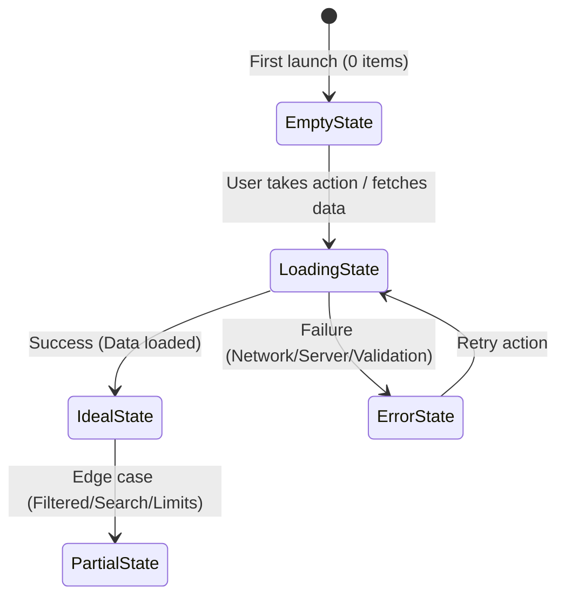

# User Journey Canvas & State Architecture Guide

When building high-impact products, the technical architecture must be grounded in an intuitive, friction-free User Journey. Features fail most frequently not from bad code, but from broken edge-case flows, confusing empty states, and unhandled errors.

---

## 1. The First-Mile Experience: Time-to-First-Value (TTFV)

The "First Mile" is the initial 30 to 120 seconds a user interacts with your product or feature.

### Golden Rules:
1. **Accelerate to the "Aha!" Moment**: How many clicks, inputs, or seconds between opening the feature and experiencing value? Strip away every non-essential barrier.
2. **Never Demand Empty Homework**: Don't force users to configure 10 settings or fill out an empty form before showing them what the product can do. Provide sensible defaults, pre-filled samples, or a 1-click starter.
3. **Progressive Disclosure**: Show only what the user needs right now. Reveal advanced controls and settings contextually as they become relevant.

---

## 2. The Complete 5-State Architecture

Every screen, component, or CLI command exists in one of five states. Ensure all five are designed before implementation starts:

### State 1: Ideal State (The Happy Path)
- **Description**: The interface when data exists, user inputs are valid, and operations succeed immediately.
- **Design Check**: Is the primary action visually prominent? Is visual hierarchy clear? Is the cognitive load minimized?

### State 2: Empty State (Zero-Data State)
- **Description**: The user has just installed the tool, opened a new project, or cleared their list.
- **Common Mistake**: Showing a blank grey box with "No items found."
- **Best Practice**:
  - Educational graphic or clear heading explaining what belongs here.
  - Value proposition reminder: *"Projects let you organize tasks across teams."*
  - Single primary Call-to-Action: *"Create your first project"* or *"Import from template"*.

### State 3: Loading & Progress State
- **Description**: Waiting for an API call, file upload, compilation, or LLM inference.
- **Design Check**:
  - **< 300ms**: No indicator needed (prevents visual flickering).
  - **300ms - 2s**: Subtle spinner or skeleton placeholder matching the layout.
  - **> 2s**: Progress bar with percentage, estimated time remaining, or step-by-step indicator (*"Indexing files... 45%"*).
  - Allow cancellation where long-running operations might hang.

### State 4: Error & Recovery State
- **Description**: Something went wrong (validation error, 500 server error, network offline, permission denied).
- **Common Mistake**: *"An error occurred: [Object object]"* or cryptic internal stack traces.
- **Best Practice**:
  - **What happened** (Plain language, user-centric).
  - **Why it happened** (Root cause without internal jargon).
  - **How to recover** (Clear action: *"Check your network and Retry"*, *"File exceeds 10MB limit. Select a smaller file."*).

### State 5: Partial / Edge-Case States
- **Description**: Extreme values, boundary conditions, or abnormal volume.
- **Checklist**:
  - **Text Truncation**: Does long text wrap, ellipsis, or break the layout?
  - **Zero Results**: Search query returned 0 matches? Offer spelling suggestions or a *"Clear search filter"* link.
  - **Extreme Data**: What happens with 10,000 items? (Virtual scrolling, pagination).
  - **Rate Limiting**: What happens when API rate limits are hit? (Exponential backoff, user notification with countdown).

---

## 3. Microcopy & Cognitive Friction Checklist

- **Button Labels**: Use verbs that describe the outcome (`"Create Project"`, `"Save Changes"`, `"Export PDF"` instead of generic `"OK"`, `"Submit"`).
- **Destructive Actions**: Use clear warning modals for irreversible data loss (`"Delete Workspace"`). Require explicit confirmation for high-stakes actions.
- **Form Inputs**: Provide helpful placeholder hints, inline validation (on blur, not while typing), and clear error messages right below the input field.
- **System Feedback**: Provide toast messages or visual confirmations for background operations (`"Changes saved automatically"`, `"Link copied to clipboard"`).
