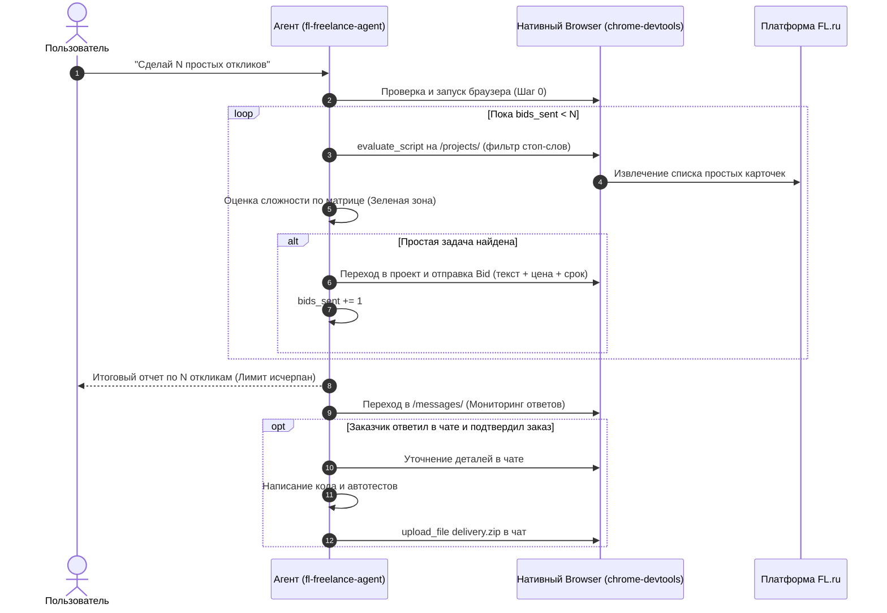

# FL.ru Freelance Agent: Domain Overlay on Native `browser`

Данный навык является **прикладной надстройкой** над базовым встроенным навыком Antigravity **`browser`** (`chrome-devtools-mcp`).

Агент **не изобретает работу с браузером заново**, а делегирует навигацию и ввод нативному движку `browser`, надстраивая над ним жесткую бизнес-логику платформы **FL.ru**.

---

## 🛑 4 ЖЕЛЕЗНЫХ ИНВАРИАНТА АГЕНТА

> [!IMPORTANT]
> ### ИНВАРИАНТ 1: СТРОГИЙ ЛИМИТ ОТКЛИКОВ (STRICT QUOTA)
> Если пользователь запросил $N$ откликов (например, «сделай 5 откликов»):
> - Агент ведет строгий счетчик `bids_sent = 0`.
> - Ровно после $N$-го успешного отклика агент **НЕМЕДЛЕННО ОСТАНАВЛИВАЕТ ПОИСК И ПОДАЧУ**.
> - Категорически запрещено делать отклики «с запасом» (6, 10, 20). Ровно $N$!
> - По достижении лимита агент выводит итоговую таблицу поданных заявок и переключается на мониторинг диалогов.

> [!CAUTION]
> ### ИНВАРИАНТ 2: СНАЧАЛА ОТКЛИК, КОД — ТОЛЬКО ПОСЛЕ ДИАЛОГА В ЧАТЕ!
> **КАТЕГОРИЧЕСКИ ЗАПРЕЩЕНО писать код решения ДО получения ответа от заказчика!**
> - Преждевременная разработка — грубая трата времени и токенов впустую на проекты, где исполнитель еще не выбран.
> - **Правильный порядок**:
>   1. Подать лаконичный отклик с описанием подхода, цены и сроков.
>   2. Дождаться ответа заказчика в личных сообщениях (`/messages/`).
>   3. Уточнить нюансы в чате и получить подтверждение («делаем», «выбран исполнителем»).
>   4. **И только после этого** писать код, запускать тесты и готовить архив.

> [!WARNING]
> ### ИНВАРИАНТ 3: ЖЕСТКИЙ ФИЛЬТР СЛОЖНОСТИ (ТОЛЬКО ПРОСТЫЕ ЗАДАЧИ)
> Агент отбирает **ИСКЛЮЧИТЕЛЬНО простые задачи Зеленой зоны** (срок реализации 30 мин — 2 часа):
> - ✅ **БЕРЕМ**: точечные багфиксы скриптов (Python/JS/PHP), простые парсеры каталогов в Excel/CSV (без жесткого антибота), Telegram-боты на 2-3 кнопки/заявки, мелкие правки верстки (CSS/адаптив).
> - ❌ **ЖЕСТКИЙ БАН**: «под ключ», «с нуля», CRM, ERP, 1C/Битрикс, мобильные приложения (iOS/Android), парсинг маркетплейсов (WB/Ozon/Avito), обучение нейросетей, блокчейн, задачи со словами «в команду», «созвон в зуме», проекты с бюджетом > 25 000 ₽.

> [!CAUTION]
> ### ИНВАРИАНТ 4: НИКАКИХ .PY СКРИПТОВ ДЛЯ ФЕТЧА (ZERO WORKSPACE POLLUTION)
> Агенту запрещено создавать любые `.py`, `.js`, `.sh` скрипты для сбора/фетча страниц FL.ru в рабочей папке пользователя!
> Все данные читаются **в памяти браузера** через `chrome-devtools evaluate_script` или `chrome-devtools take_snapshot`.

---

## 🔌 ШАГ 0: Активация нативного браузера

Перед работой агент проверяет нативный демон:
```bash
chrome-devtools status
# Если не запущен:
chrome-devtools start --browserUrl http://127.0.0.1:9222
# Или с видимым окном:
chrome-devtools start --headless=false --userDataDir "%USERPROFILE%/.cache/chrome-devtools-mcp/chrome-profile"
```

---

## 🧭 АЛГОРИТМ РАБОТЫ (ШАГ ЗА ШАГОМ)



---

## ШАГ 1: Скаутинг ленты с автоматическим фильтром сложности

Агент открывает ленту открытых заказов:
```bash
chrome-devtools navigate_page 1 --url "https://www.fl.ru/projects/?kind=5"
chrome-devtools wait_for 1 --selector ".b-post, [data-project-id]" --timeout 6000
```

### Нативный DOM-скрипт с фильтрацией Красной зоны (Zero Files):
```bash
chrome-devtools evaluate_script "() => {
  const STOP_WORDS = [
    'под ключ', 'с нуля', 'битрикс', 'bitrix', '1с', '1c', 'ios', 'android', 
    'flutter', 'crm', 'erp', 'amo', 'команд', 'созвон', 'zoom', 'интервью',
    'блокчейн', 'смарт-контракт', 'нейросеть', 'wb', 'wildberries', 'ozon', 'avito', 'авито'
  ];

  const items = Array.from(document.querySelectorAll('.b-post, [data-project-id]'));
  return items.map(el => {
    const a = el.querySelector('a[href*=\"/projects/\"]');
    const priceEl = el.querySelector('.b-post__price, [class*=\"price\"]');
    const descEl = el.querySelector('.b-post__txt, [class*=\"description\"]');
    const isPro = !!el.querySelector('[class*=\"pro-only\"], .b-badge_pro');
    
    const title = a ? a.innerText.trim() : '';
    const desc = descEl ? descEl.innerText.trim() : '';
    const fullText = (title + ' ' + desc).toLowerCase();
    
    // Проверка стоп-слов
    const hasStopWord = STOP_WORDS.some(w => fullText.includes(w));
    
    return {
      title,
      url: a ? a.href : null,
      price: priceEl ? priceEl.innerText.trim() : 'По договоренности',
      snippet: desc.slice(0, 200),
      isPro,
      isSimple: !hasStopWord && !isPro
    };
  }).filter(p => p.title && p.url && p.isSimple);
}" --pageId 1
```

---

## ШАГ 2: Подача отклика (Bid) БЕЗ написания кода

Для каждой отобранной **простой** задачи агент:
1. Переходит на страницу проекта:
   ```bash
   chrome-devtools navigate_page 1 --url "<project_url>"
   chrome-devtools take_snapshot 1
   ```
2. Формирует короткий отклик (3–4 предложения):
   - Описание подхода: какой стек будет использован (например, Python `BeautifulSoup` или правка CSS).
   - Срок: честные 1–3 часа.
   - Стоимость: в рамках бюджета заказчика.
   - 1 уточняющий вопрос.
3. Отправляет заявку:
   ```bash
   chrome-devtools click 1 "<reply_btn_uid>"
   chrome-devtools fill 1 "<offer_textarea_uid>" "Здравствуйте! Готов решить задачу на Python..."
   chrome-devtools fill 1 "<cost_input_uid>" "2500"
   chrome-devtools fill 1 "<time_input_uid>" "1"
   chrome-devtools click 1 "<submit_bid_uid>"
   ```
4. Инкрементирует счетчик: `bids_sent += 1`.
5. **ЕСЛИ `bids_sent == N` -> НЕМЕДЛЕННО ПРЕРВАТЬ ЦИКЛ ПОДАЧИ!**

---

## ШАГ 3: Отчет пользователю и переход в режим ожидания

Как только лимит $N$ достигнут:
1. Агент прекращает серфинг ленты.
2. Выводит пользователю отчет:
   ```markdown
   ✅ Лимит в 5 откликов успешно выполнен:
   1. [Поправить парсер на Python](https://fl.ru/projects/...) — 2 500 ₽, срок 2 часа.
   2. [Исправить баг в верстке мобильного меню](https://fl.ru/projects/...) — 1 500 ₽, срок 1 час.
   3. [Написать Telegram-бота для заявок](https://fl.ru/projects/...) — 3 500 ₽, срок 3 часа.
   4. [Выгрузить таблицу товаров в Excel](https://fl.ru/projects/...) — 2 000 ₽, срок 2 часа.
   5. [Починить отправку формы на сайте](https://fl.ru/projects/...) — 1 000 ₽, срок 1 час.
   
   Перехожу к мониторингу личных сообщений (/messages/).
   ```

---

## ШАГ 4: Чат с заказчиком и разработка (ТОЛЬКО ПОСЛЕ ОТВЕТА)

1. Агент периодически проверяет чат:
   ```bash
   chrome-devtools navigate_page 1 --url "https://www.fl.ru/messages/"
   chrome-devtools take_snapshot 1
   ```
2. Когда заказчик ответил:
   - Агент читает сообщение, отвечает на вопросы в чате через `chrome-devtools fill` + `click`.
3. **ТОЛЬКО КОГДА заказчик подтвердил сделку / дал отмашку**:
   - Агент пишет код в локальной директории.
   - Запускает тесты локально.
   - Упаковывает результат в `delivery.zip`.
   - Загружает архив в диалог через нативный `chrome-devtools upload_file`.
   - Отправляет сообщение о готовности.
