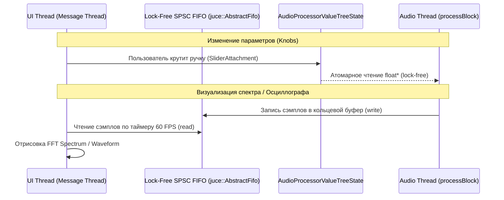

# VST3 & Audio DSP Architect

Авторитетное руководство по разработке профессиональных VST3 и VST3i (инструменты/синтезаторы) аудиоплагинов, алгоритмов цифровой обработки сигналов (DSP) и фреймворка JUCE.

---

## ⚡ Священные законы Real-Time Audio Thread

Аудиопоток (Audio Thread) вызывается драйвером звуковой карты (ASIO/CoreAudio) каждые несколько миллисекунд (например, 128 сэмплов при 48 кГц = 2.66 мс). Если метод `processBlock()` не успеет вернуть буфер вовремя — пользователь услышит щелчок (audio dropout / glitch / xrun).

### 3 Запрета в `processBlock()` (Real-Time Safety):
1. **Никаких динамических аллокаций памяти**:
   - ❌ `malloc()`, `free()`, `new`, `delete`, `std::vector::push_back()`, создание `std::string`.
   - ✅ Все буферы, таблицы синусов и линии задержки аллоцируются строго в `prepareToPlay(sampleRate, samplesPerBlock)` или конструкторе.
2. **Никаких блокировок и системных вызовов**:
   - ❌ `std::mutex`, `std::lock_guard`, `std::condition_variable`, `Sleep()`, ожидание семафоров.
   - ❌ Дисковый ввод-вывод (чтение файлов, пресетов, сэмплов).
   - ❌ Сетевые сокеты и логирование в консоль (`std::cout`, `printf`, `DBG()`).
3. **Безамплитудное изменение параметров**:
   - ❌ Мгновенная смена частоты среза фильтра или громкости (вызывает треск / zipper noise).
   - ✅ Использование сглаживателей параметров: `juce::SmoothedValue<float, juce::ValueSmoothingTypes::Linear>` или `Multiplicative`.

---

## 🔄 Межпоточная связь: UI Thread $\leftrightarrow$ Audio Thread

Графический интерфейс работает со скоростью 60 FPS ($\approx 16.6$ мс), а аудиопоток — с частотой сотен герц.



- **Параметры**: Используйте строго `juce::AudioProcessorValueTreeState` (APVTS). В `processBlock` считывайте значение через `apvts.getRawParameterValue("param_id")->load(std::memory_order_relaxed)`.
- **Спектр и волноформы**: Передавайте сэмплы из аудиопотока в UI исключительно через `juce::AbstractFifo` с кольцевым буфером без блокировок.

---

## 🎛️ Фундаментальные алгоритмы DSP

### 1. Государственно-переменный фильтр (State Variable Filter, SVF)
Аналогово-моделированный TPT (Topology-Preserving Transform) фильтр без расстройки на высоких частотах:

```cpp
// Обработка одного сэмпла через TPT SVF:
template <typename SampleType>
SampleType processSVF(SampleType x, SampleType g, SampleType k, SampleType& s1, SampleType& s2) {
    SampleType hp = (x - (k + g) * s1 - s2) / (SampleType(1) + g * (k + g));
    SampleType v1 = g * hp;
    SampleType bp = v1 + s1;
    s1 = bp + v1;
    SampleType v2 = g * bp;
    SampleType lp = v2 + s2;
    s2 = lp + v2;
    return lp; // Или bp, hp, notch
}
```

### 2. Сглаживание алиасинга осцилляторов: PolyBLEP
Прямоугольная (Square) и пилообразная (Saw) волны имеют бесконечный спектр гармоник. Без подавления возникает тяжелый цифровой алиасинг (зеркальные паразитные частоты).
Используйте **PolyBLEP (Polynomial Bandlimited Step)** для сглаживания ступенек:

```cpp
float polyBLEP(float t, float dt) {
    if (t < dt) {
        t /= dt;
        return t + t - t * t - 1.0f;
    } else if (t > 1.0f - dt) {
        t = (t - 1.0f) / dt;
        return t * t + t + t + 1.0f;
    }
    return 0.0f;
}
```

### 3. Нелинейное аналоговое насыщение (Saturation & Warmth)
Смягчение цифрового пика и генерация теплых гармоник:
- **Мягкий клиппинг (Cubic Soft Clipping)**:
  $$f(x) = x - \frac{1}{3} x^3 \quad (\text{для } |x| \le 1)$$
- **Ламповое / диодное насыщение**:
  $$f(x) = \tanh(\text{drive} \cdot x)$$
  *(В hot path используйте быстрый аппроксимант $\tanh$: $\frac{x}{1 + |x|}$ или Padé аппроксимацию).*

---

## 🎹 Специфика VST3i (Инструменты и Синтезаторы)

1. **Обработка MIDI**: Итерация по `juce::MidiBuffer` с учетом сэмпловой позиции внутри блока (`metadata.samplePosition`).
2. **Голосовая архитектура (Polyphonic Voice Management)**:
   - Пул голосов (обычно 8, 16 или 32 голоса).
   - Voice Stealing: при исчерпании голосов алгоритм забирает самый старый или самый тихий отзвучавший голос (минимальная энергия огибающей).
3. **MPE (MIDI Polyphonic Expression)**: Поддержка раздельного Pitch Bend и Timbre (CC74) на каждую индивидуальную клавишу.

---

## 🧪 Валидация и стресс-тестирование плагина

Перед релизом плагин ОБЯЗАН пройти проверку утилитой `pluginval` от Tracktion:

```bash
pluginval --strictness-level 10 --validate-in-process --output-dir ./reports ./Builds/Release/MyPlugin.vst3
```

### Обязательные стресс-проверки:
- [ ] Тест на нечетные и экстремальные размеры буфера: 1 сэмпл, 31 сэмпл, 64, 512, 4096 сэмплов.
- [ ] Переключение частоты дискретизации на лету (44.1 kHz $\to$ 96 kHz $\to$ 192 kHz).
- [ ] Корректность сохранения и восстановления состояния сессии DAW (`getStateInformation` / `setStateInformation`).
- [ ] Полное отсутствие утечек памяти (прогон под AddressSanitizer в тестовом хосте).
- [ ] Denormal numbers: добавление анти-денормал защиты (`juce::ScopedNoDenormals`).
